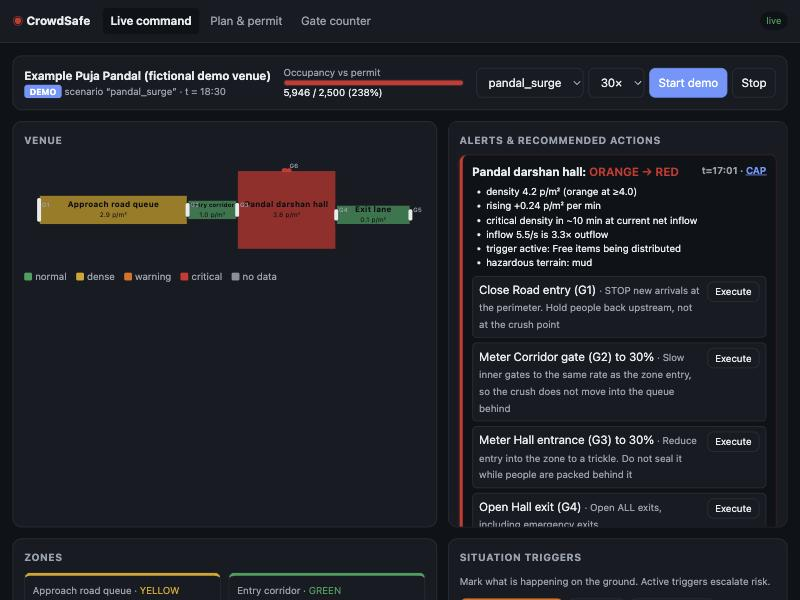
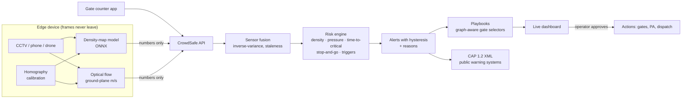

# CrowdSafe

**Open-source crowd-crush prevention for any gathering: religious, entertainment, sports or political.**

CrowdSafe helps an administrative body, from a village temple committee to a national disaster authority, to:

1. **Plan**: compute a venue's *safe* capacity and assess the event's risk before granting a permit.
2. **See**: measure crowd density (people/m²) and motion live, from existing CCTV, phones or gate counters.
3. **Predict**: warn *minutes before* a zone becomes critical ("Hall reaches critical density in ~10 min").
4. **Act**: turn every alert into pre-approved, explained actions: which gate to close, which to open, and what to announce in Hindi, Bengali or English.

> People die in crowd crushes from compressive asphyxia, often while standing still. The causes are
> structural: too many people, too few exits, a surge trigger, and decisions that come too late.
> All of that is measurable, and therefore preventable.

<p align="center"></p>

---

## Try it in 60 seconds

```bash
git clone https://github.com/abhieq31/crowdsafe && cd crowdsafe
python3 -m venv .venv && source .venv/bin/activate
pip install -e ".[server]"
crowdsafe demo            # open http://127.0.0.1:8000
```

The demo simulates an evening rush at a puja pandal. Free prasad starts in the hall, word spreads, and people stop on the exit steps.
Watch the hall go from green to red. Then press **Execute all** on the RED alert and watch the crowd recover.

No browser? The same scenario runs headless:

```bash
crowdsafe simulate                  # no action: the hall reaches 7.4 p/m² (crush conditions)
crowdsafe simulate --respond        # playbook executed: every zone stays below 3.7 p/m²
crowdsafe capacity --area 960 --exit 3 --exit 2.5
```

### What the demo shows (reproducible, see `tests/test_core.py`)

| | Without response | With CrowdSafe playbook |
|---|---|---|
| First warning (ORANGE) | t = 4.6 min | same |
| RED alert | t = 17.0 min | same |
| True density hits critical (6.5 p/m²) | t = 30.0 min, **13 min after the RED alert** | never |
| Peak density in any zone | 7.4 p/m² | 3.7 p/m² |
| False ORANGE/RED alarms in the `steady` baseline | 0 | 0 |

An early version of the playbook simply sealed the hall entrance. The simulator showed the crush moving
into the corridor behind it (9 p/m²). The default playbook now follows the crowd-safety rule
**hold people back upstream, never seal the gate at the crush point**, and a regression test enforces it.

---

## Deployment tiers: same code, any budget

| Tier | Who | Needs | Gets |
|---|---|---|---|
| **0 · Phone** | Temple committee, small rally | A phone browser | Offline capacity planner, permit risk check, printable safety plan, volunteer gate counter |
| **1 · Laptop** | District police, college fest | 1 laptop + a few phones or CCTV | Live density map, explained alerts, playbooks |
| **2 · Control room** | City police, stadiums, Durga Puja and Rath Yatra committees | Edge boxes + server | Many cameras, CAP alerts to public warning systems |
| **3 · Mega event** | Kumbh, Hajj, national DMA | Cluster | Multi-site, forecasting, inter-agency dashboards (roadmap) |

---

## How it works



### The science, encoded

| Signal | Why it matters | Where |
|---|---|---|
| **Density** (p/m²) with Fruin Level of Service | Above ~4 p/m² a moving crowd is unsafe, and at ~6-7 people lose control of their movement | `physics.py` |
| **Crowd pressure** = ρ · Var(v) | Helbing et al. (2007) found it signals turbulence before crushes (Hajj 2006 video) | `physics.py`, `vision/motion.py` |
| **Time-to-critical** = (ρc − ρ)·A / (in − out) | The one number an operator needs | `physics.py`, `zones.py` |
| **Stop-and-go waves** | Detrended autocorrelation of speed. These waves appear minutes before turbulence | `physics.dominant_oscillation` |
| **Surge triggers** | Free distribution, rumours, gate changes, VIPs, rain, event end (Singh & Kishore 2025) | `alerts.py` |
| **Exit flow** 82 p/m/min (66 on stairs) | Safe capacity is limited by how fast people can leave, assuming the largest exit is blocked | `planning.py` |

### Engineering choices

- **Pure-Python core, no dependencies.** The engine runs on anything, including a Raspberry Pi or Termux on Android.
- **Edge-first and privacy by design.** Video is processed on the device and only per-zone numbers are sent (around 200 B/s per camera).
  There is **no face recognition and no individual tracking**, and there never will be. See [ETHICS.md](ETHICS.md).
- **Fail loud.** A camera that goes silent turns its zone **UNKNOWN** (grey, ranked like ORANGE). It never shows "safe".
- **Explainable.** Every alert lists its reasons, and every recommended action carries a note explaining why.
- **Interoperable.** Alerts export as **CAP 1.2** (`/api/alerts/{id}/cap`), the OASIS standard used by national alert systems.
- **One logic, two runtimes.** The offline browser planner (`web/js/planning.js`) and the Python planner are checked against shared test vectors.
- **Honest vision.** Bounding-box detectors undercount dense crowds, so the primary path is a density-map model. See [docs/vision.md](docs/vision.md).

---

## Live mode with real cameras

```bash
pip install -e ".[server,vision,onnx]"
crowdsafe serve --venue my_venue.json                 # control-room server
crowdsafe edge --source rtsp://cam1/stream \
               --calibration cam1.json --model density.onnx \
               --server http://control-room:8000      # on each edge device
```

Any sensor can post to the API:

```bash
curl -X POST localhost:8000/api/observations -H 'Content-Type: application/json' \
  -d '[{"zone_id":"hall","source":"turnstile-3","count":1450,"density_sigma":0.3}]'
```

Venue format: [`src/crowdsafe/data/venues/pandal.json`](src/crowdsafe/data/venues/pandal.json).
Playbook format: [`src/crowdsafe/data/default_playbook.json`](src/crowdsafe/data/default_playbook.json).
API docs: `http://localhost:8000/docs`.

## Development

```bash
pip install -e ".[dev]"
pytest              # 38 tests: physics, planning, fusion, alerts, CAP, end-to-end sims, API, vision
node --test tests/js/*.test.mjs
ruff check src tests
docker compose up   # demo in a container
```

## Roadmap

See [docs/PLAN.md](docs/PLAN.md) for the full design. Next steps:

- [ ] Venue editor (draw zones on OpenStreetMap)
- [ ] JuPedSim agent-level simulation for permit review
- [ ] Spatio-temporal GNN forecaster, plus replay benchmarks of historical incidents
- [ ] Fine-tuned density model on Indian festival footage, with published accuracy
- [ ] Marshal mobile app (offline, push alerts), SMS/IVR gateway, cell broadcast adapter
- [ ] Multi-venue control room, Keycloak auth, Helm chart

**Contributions are very welcome**, especially from crowd-safety practitioners, police and disaster
management officers, and translators. See [CONTRIBUTING.md](CONTRIBUTING.md).

## References

- Singh J.P., Kishore M. (2025). *Framework for stampede management: Preventable mass disaster.* IP Int. J. Forensic Med. Toxicol. Sci. 10(1):3-8.
- Helbing D., Johansson A., Al-Abideen H.Z. (2007). *Dynamics of crowd disasters: An empirical study.* Phys. Rev. E 75, 046109.
- Fruin J.J. (1971). *Pedestrian Planning and Design.*
- Weidmann U. (1993). *Transporttechnik der Fussgänger.*
- Sports Grounds Safety Authority. *Guide to Safety at Sports Grounds (Green Guide).*
- NDMA India (2014). *Managing Crowds at Events and Venues of Mass Gathering.*
- OASIS. *Common Alerting Protocol v1.2.*
- [List of fatal crowd crushes (Wikipedia)](https://en.wikipedia.org/wiki/List_of_fatal_crowd_crushes)

## License

Apache-2.0. CrowdSafe is decision support. Trained people make the decisions and remain responsible for them.
