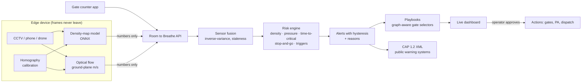

# Room to Breathe

**Open-source crowd-crush prevention for any gathering: religious, entertainment, sports or political.**

People in a crowd crush die because they cannot breathe: the crowd presses on their chests until there is
no room to take a breath. Everything in this project serves one goal: **keep room to breathe for every
person, in every crowd.**

Room to Breathe helps an administrative body, from a village temple committee to a national disaster authority, to:

1. **Plan**: compute a venue's *safe* capacity and assess the event's risk before granting a permit.
2. **See**: measure crowd density (people/m²) and motion live, from existing CCTV, phones or gate counters.
3. **Predict**: warn *minutes before* a zone becomes critical ("Hall reaches critical density in ~10 min").
4. **Act**: turn every alert into pre-approved, explained actions: which gate to close, which to open, and what to announce in Hindi, Bengali or English.

> People die in crowd crushes from compressive asphyxia, often while standing still. The causes are
> structural: too many people, too few exits, a surge trigger, and decisions that come too late.
> All of that is measurable, and therefore preventable.

### ▶ [Open the web app](https://abhieq31.github.io/roomtobreathe/): nothing to install

Works on any phone or computer browser. It asks two things and gives one answer:

1. **Where is your event?** Find it on the map (satellite view, anywhere in the world), trace the area people
   will stand in, and tap across each gate. Areas and gate widths are measured for you.
2. **How many people are coming?**

**Check my event** then says *Safe*, *Possible with precautions* or *Not safe*, with the reasons and what to
change. It runs the checks a crowd-safety expert would: capacity with the largest exit blocked, crowding as
people arrive, a sudden surge (with and without the response plan), and a full evacuation. The engine is the
same one the live control room uses, running inside your browser.

**3. The area around the venue** then plans the surroundings as well as the venue itself. Using free
OpenStreetMap data, it routes the crowd and its traffic through the real streets, stations and stops, both
arriving and leaving. It finds the outside choke points, which roads to close (each with a diversion), and the
junctions where crowd meets traffic. It names the receiving hospitals with drive times under event traffic,
and plans an ambulance route that avoids the crowd. Then it says **where to place police, traffic police,
first aid, ambulances, stewards and station staff, how many, when and why**, on one map with a printable plan
for every agency, plus a briefing sheet for each agency. If a street on the map is wrong, tap it to correct its
footpath width or mark it closed or blocked, then re-plan in seconds. On the command line:
`rtb overview venue.json --people 60000 --html plan.html --briefings briefings/`.
How it works and its limits: [docs/SURROUNDINGS.md](https://github.com/abhieq31/roomtobreathe/blob/main/docs/SURROUNDINGS.md).

<p align="center"></p>

Also in the app: **Count a crowd** from a photo (people per m², the photo never leaves your device), a
**Gate counter** for volunteers, and a **Permit check**. Planners can open *Try your own scenario* for
surges, blocked gates and evacuations of their choosing. On the command line: `rtb assess venue.json --people 12000`.

Live monitoring of real cameras runs on a computer at your venue: see [Use it at a real event](#use-it-at-a-real-event).

<p align="center"></p>

---

## Try it in 60 seconds

```bash
python3 -m venv .venv && source .venv/bin/activate
pip install "roomtobreathe[server]"
roomtobreathe demo            # open http://127.0.0.1:8000
```

Or run it in Docker: `docker run -p 8000:8000 ghcr.io/abhieq31/roomtobreathe`.

The demo simulates an evening rush at a puja pandal. Free prasad starts in the hall, word spreads, and people stop on the exit steps.
Watch the hall go from green to red. Then press **Execute all** on the RED alert and watch the crowd recover.

No browser? The same scenario runs headless:

```bash
roomtobreathe simulate                  # no action: the hall reaches 7.4 p/m² (crush conditions)
roomtobreathe simulate --respond        # playbook executed: every zone stays below 3.7 p/m²
roomtobreathe capacity --area 960 --exit 3 --exit 2.5
```

### What the demo shows (reproducible, see `tests/test_core.py`)

| | Without response | With the Room to Breathe playbook |
|---|---|---|
| First warning (ORANGE) | t = 4.6 min | same |
| RED alert | t = 17.0 min | same |
| True density hits critical (6.5 p/m²) | t = 30.0 min, **13 min after the RED alert** | never |
| Peak density in any zone | 7.4 p/m² | 3.7 p/m² |
| False ORANGE/RED alarms in the `steady` baseline | 0 | 0 |

An early version of the playbook simply sealed the hall entrance. The simulator showed the crush moving
into the corridor behind it (9 p/m²). The default playbook now follows the crowd-safety rule
**hold people back upstream, never seal the gate at the crush point**, and a regression test enforces it.

---

## Use it at a real event

**Read [docs/DEPLOY.md](https://github.com/abhieq31/roomtobreathe/blob/main/docs/DEPLOY.md).** It walks a district office or organising committee through the
whole event, from the physics that sets the time margin to the after-action record. The short version:

| When | Step | Command |
|---|---|---|
| A week before | Describe the venue; get its safe capacity and structural warnings | `roomtobreathe venue new my_venue.json` |
| A week before | Calibrate each camera to the ground in metres | [vision.md §1](https://github.com/abhieq31/roomtobreathe/blob/main/docs/vision.md#1-calibrate-each-camera-once) |
| Day before | Start the control room (Docker or Python) | `docker compose up -d` or `roomtobreathe serve --venue my_venue.json --host 0.0.0.0` |
| Day before | Set up and test each camera device | `roomtobreathe setup`, then `roomtobreathe check` (must say READY) |
| Day before | Rehearse: unplug a camera and confirm its zone turns grey and alerts | |
| On the day | Run each camera device; operators sign in by name | `roomtobreathe edge` |
| After | Keep the event record (every alert and approved action, with names) | `roomtobreathe-logs/*.jsonl` |

Ready-made images: `ghcr.io/abhieq31/roomtobreathe` (control room) and `ghcr.io/abhieq31/roomtobreathe-edge`
(camera device, density model included, works offline).

---

## Deployment tiers: same code, any budget

| Tier | Who | Needs | Gets |
|---|---|---|---|
| **0 · Phone** | Temple committee, small rally | A phone browser | Offline capacity planner, permit risk check, printable safety plan, volunteer gate counter |
| **1 · Laptop** | District police, college fest | 1 laptop + a few phones or CCTV | Live density map, explained alerts, playbooks |
| **2 · Control room** | City police, stadiums, Durga Puja and Rath Yatra committees | Edge boxes + server | Many cameras, CAP alerts to public warning systems |
| **3 · Mega event** | Kumbh, Hajj, national DMA | Cluster | Multi-site, forecasting, inter-agency dashboards (roadmap) |

---

## How it works



### The science, encoded

| Signal | Why it matters | Where |
|---|---|---|
| **Density** (p/m²) with Fruin Level of Service | Above ~4 p/m² a moving crowd is unsafe, and at ~6-7 people lose control of their movement | `physics.py` |
| **Crowd pressure** = ρ · Var(v) | Helbing et al. (2007) found it signals turbulence before crushes (Hajj 2006 video) | `physics.py`, `vision/motion.py` |
| **Time-to-critical** = (ρc − ρ)·A / (in − out) | The one number an operator needs | `physics.py`, `zones.py` |
| **Stop-and-go waves** | Detrended autocorrelation of speed. These waves appear minutes before turbulence | `physics.dominant_oscillation` |
| **Surge triggers** | Free distribution, rumours, gate changes, VIPs, rain, event end (Singh & Kishore 2025) | `alerts.py` |
| **Exit flow** 82 p/m/min (66 on stairs) | Safe capacity is limited by how fast people can leave, assuming the largest exit is blocked | `planning.py` |

### Engineering choices

- **Pure-Python core, no dependencies.** The engine runs on anything, including a Raspberry Pi or Termux on Android.
- **Edge-first and privacy by design.** Video is processed on the device and only per-zone numbers are sent (around 200 B/s per camera).
  There is **no face recognition and no individual tracking**, and there never will be. See [ETHICS.md](https://github.com/abhieq31/roomtobreathe/blob/main/ETHICS.md).
- **Fail loud.** A camera that goes silent turns its zone **UNKNOWN** (grey, ranked like ORANGE). It never shows "safe".
- **Explainable.** Every alert lists its reasons, and every recommended action carries a note explaining why.
- **Interoperable.** Alerts export as **CAP 1.2** (`/api/alerts/{id}/cap`), the OASIS standard used by national alert systems.
- **One logic, two runtimes.** The offline browser planner (`web/js/planning.js`) and the Python planner are checked against shared test vectors.
- **Honest vision.** Bounding-box detectors undercount dense crowds, so the primary path is a density-map model. See [docs/vision.md](https://github.com/abhieq31/roomtobreathe/blob/main/docs/vision.md).

---

## Live mode with real cameras

**On the control-room computer:**

```bash
pip install "roomtobreathe[server]"
roomtobreathe serve --venue my_venue.json --host 0.0.0.0     # set RTB_TOKEN to require a password
```

**On each camera device (a laptop or mini-PC next to the CCTV recorder):**

```bash
pip install "roomtobreathe[vision,onnx]"
roomtobreathe setup     # once: camera, calibration file, control-room address, token, model
roomtobreathe check     # the day before the event
roomtobreathe edge      # on the day
```

1. `roomtobreathe setup` asks one question at a time in plain words and tests each answer straight away, so a
   wrong camera address or password shows up while you are still standing next to the camera. It offers to
   download the 86 MB density model (checksum verified). Run it again to change an answer: press Enter to
   keep the ones that are fine.
2. The answers are saved on this device only, in your user's settings folder (`roomtobreathe setup` prints
   where: `~/.config/roomtobreathe/edge.json` on Linux, `~/Library/Application Support/roomtobreathe/` on macOS,
   `%APPDATA%\roomtobreathe\` on Windows). The access token is typed hidden, never printed, and the file can
   only be read by your user account. Set `RTB_HOME` to keep it somewhere else.
3. Options you type always win over the saved answers, e.g. `roomtobreathe edge --source 1` to try another camera,
   or the full form without any setup:
   `roomtobreathe edge --source rtsp://cam1/stream --calibration cam1.json --server http://control-room:8000`.
4. The calibration file maps the camera's picture to the ground in metres, once per camera. See
   [docs/vision.md](https://github.com/abhieq31/roomtobreathe/blob/main/docs/vision.md#1-calibrate-each-camera-once).
5. **Run `roomtobreathe check` the day before the event.** It tests the camera, the calibration, the model, this
   device's speed and the connection to the control room. Every problem comes with a fix in plain words.
   It also catches the most common silent mistake: a zone name that doesn't match the venue file.
6. `roomtobreathe edge` measures the device's speed. On a slow device it reports less often and says so, instead
   of quietly falling behind. It never shrinks the picture to go faster, because that undercounts dense crowds.
7. No internet at the venue? Run `roomtobreathe model fetch` anywhere and copy the `models` folder it prints
   (`roomtobreathe model list`) to the device.

Any sensor can post to the API:

```bash
curl -X POST localhost:8000/api/observations -H 'Content-Type: application/json' \
  -d '[{"zone_id":"hall","source":"turnstile-3","count":1450,"density_sigma":0.3}]'
```

Venue format: [`src/roomtobreathe/data/venues/pandal.json`](https://github.com/abhieq31/roomtobreathe/blob/main/src/roomtobreathe/data/venues/pandal.json).
Playbook format: [`src/roomtobreathe/data/default_playbook.json`](https://github.com/abhieq31/roomtobreathe/blob/main/src/roomtobreathe/data/default_playbook.json).
API docs: `http://localhost:8000/docs`.

## Development

```bash
pip install -e ".[dev]"
pytest              # physics, planning, fusion, alerts, CAP, end-to-end sims, API, vision, setup tools
node --test tests/js/*.test.mjs
ruff check src tests scripts
docker compose up   # control room in a container (demo unless data/venue.json exists)
```

## Roadmap

See [docs/PLAN.md](https://github.com/abhieq31/roomtobreathe/blob/main/docs/PLAN.md) for the full design. Next steps:

- [ ] Venue editor (draw zones on OpenStreetMap)
- [ ] JuPedSim agent-level simulation for permit review
- [ ] Spatio-temporal GNN forecaster, plus replay benchmarks of historical incidents
- [ ] Fine-tuned density model on Indian festival footage, with published accuracy
- [ ] Marshal mobile app (offline, push alerts), SMS/IVR gateway, cell broadcast adapter
- [ ] Multi-venue control room, Keycloak auth, Helm chart

**Contributions are very welcome**, especially from crowd-safety practitioners, police and disaster
management officers, and translators. See [CONTRIBUTING.md](https://github.com/abhieq31/roomtobreathe/blob/main/CONTRIBUTING.md).

## References

- Singh J.P., Kishore M. (2025). *Framework for stampede management: Preventable mass disaster.* IP Int. J. Forensic Med. Toxicol. Sci. 10(1):3-8.
- Helbing D., Johansson A., Al-Abideen H.Z. (2007). *Dynamics of crowd disasters: An empirical study.* Phys. Rev. E 75, 046109.
- Fruin J.J. (1971). *Pedestrian Planning and Design.*
- Weidmann U. (1993). *Transporttechnik der Fussgänger.*
- Sports Grounds Safety Authority. *Guide to Safety at Sports Grounds (Green Guide).*
- NDMA India (2014). *Managing Crowds at Events and Venues of Mass Gathering.*
- OASIS. *Common Alerting Protocol v1.2.*
- [List of fatal crowd crushes (Wikipedia)](https://en.wikipedia.org/wiki/List_of_fatal_crowd_crushes)

## License

Apache-2.0. Room to Breathe is decision support. Trained people make the decisions and remain responsible for them.
