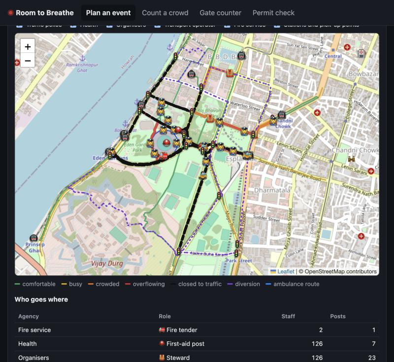

# The area around the venue

Most crowd disasters are planned inside the fence and happen outside it: the lane to the station, the
junction where taxis stop, the road the ambulance can't get through. **The area around the venue**
(web app: *Plan an event → step 3*; command line: `rtb overview`; API: `POST /api/overview`) plans
the venue *together with* its surroundings, for every agency at once.

<p align="center"></p>

## What it answers

| Question | Answer in the plan |
|---|---|
| Which streets, stations and stops overflow as people arrive and leave? | Busiest streets with their [Fruin level of service](#method), stations' busiest 15 minutes |
| What fixes them? | Road closures (applied and re-checked), a staggered exit, other routes |
| What does it do to normal traffic? | Roads pushed over capacity, a diversion for every closure, pick-up points that can't keep up |
| Where do crowd and traffic meet? | Conflict junctions, each with a traffic police post |
| How do ambulances get in? | Receiving hospitals by suitability and drive time **with event traffic**; an ambulance route that avoids the crowd |
| Who goes where, when, and why? | Every post: role, staff, place, reason, time window, grouped by agency |
| What does each agency need to know? | A briefing sheet per agency (its posts, its map, its facts) and every post as CSV |

## Using it

```bash
rtb overview my_venue.json --people 60000 \
    --modes "metro=25,rail=10,bus=25,car=20,walk=20" --html plan.html
```

The venue must be drawn on the map (it needs a location, and gates need their positions). The first run
downloads streets, stations and hospitals from OpenStreetMap's free Overpass servers. This can take 1-3
minutes, and the data is then cached for 30 days. The download runs as three requests in parallel (streets,
main roads further out, places), each **hedged** across four public servers: if one has not answered in 15 s,
the next is asked as well. Only the streets are essential: if the places fail, the plan is made without
them and says so. Options: `--arrival-minutes`, `--end-min`, `--departure-minutes`, `--public-level` (0.5 quiet,
1 city evening, 2 market area) and `--radius`. `--briefings DIR` writes one briefing sheet per agency plus `posts.csv`.

**No internet, or the servers are busy?** Plan from a map file: on openstreetmap.org, zoom to the area and
press *Export* (an `.osm` file), or save Overpass JSON from overpass-turbo.eu. Use *choose an .osm or .json
file* in the web app, or `--osm file`.

### Correct the map

OpenStreetMap almost never has footpath widths, and it does not know about tomorrow's market stalls. Tap a
coloured street on the overview map to set its **real footpath width**, mark it **closed to traffic** for the
event, or **blocked** for people on foot. A correction on a named street applies to the whole street. Re-plan
takes seconds, because the map data is not downloaded again. Corrections are kept per venue and saved in the
venue file (`"surroundings": {"overrides": {"name:Strand Road": {"walk_width": 6}}}`), so the police, the
organisers and the council all plan from the same corrected streets.

## Method

1. **Street network** from OpenStreetMap: every street within `radius` (default 1.5 km), plus main roads,
   hospitals, police and fire stations within 3 km. Station entrances are grouped into their station.
   OSM almost never records widths (around Eden Gardens, 2 of 1,085 streets), so footpath and road widths
   come from the street type (`network.ROAD_TYPES`) and the plan says so.
2. **Demand.** Attendance × travel-mode share. Each mode's people go to the nearest 3 stations or stops of
   that kind (nearer ones get more: 1/distance²). Car and taxi users are spread evenly over car parks
   (limited to their capacity) and pick-up points. Walkers head home along the streets leaving the area.
3. **Exit choice.** Each gate takes a share of its capacity, tilted towards the gates nearer each
   destination. Open gates are used both ways (entries take 35% of their capacity for leaving, and the reverse).
4. **Pedestrian assignment.** Incremental assignment in 4 steps. Walking speed on each street comes from
   its current flow (Weidmann's fundamental diagram inverted on the free-flow branch), so later people
   take parallel routes the way real crowds do.
5. **Peak flow and comfort.** Arrival and departure follow a triangular profile (peak = 2× the average), plus
   the normal public. Comfort is Fruin's walkway level of service in people per metre per minute:
   A ≤23, B ≤33, C ≤49, D ≤66, E ≤82 (the Green Guide design flow), F above it.
6. **Closures.** The worst overflowing streets within 800 m walk of a gate (level E/F, drivable, not
   motorway or trunk) are closed to traffic for the departure, with at most 8 grouped by street name. The
   crowd is then routed again with the carriageway added to the footpath.
7. **Staggered exit.** If streets still overflow after the closures, the engine computes how long the
   departure must be spread over to bring the worst street back to level D, at most 2 hours. It runs the
   departure again at that pace and adopts it in the plan if it reduces the overflow. The plan then names the
   streets that are still too narrow.
8. **Vehicles.** Car share ÷ people per vehicle (2.2). Vehicles come from every main road entering the area,
   weighted by capacity, and go to car parks and pick-up points. Routing uses BPR delays with normal traffic
   at a typical evening share of capacity. Pick-up points are placed on decent roads 250-800 m walk from the
   exits, *off the crowd's routes*, and their throughput is 6 bays × 40 vehicles an hour.
9. **Diversions** are computed after all closures, between open junctions on the connected road network.
10. **Emergency access.** Hospitals are ranked by a transparent suitability guess (`emergency=yes`, medical
   college or district hospital, government; eye, dental and maternity hospitals rank last), then by drive
   time with event traffic. The ambulance route runs from the best reachable hospital to the gate the crowd
   uses least (preferably an emergency gate), with crowded streets penalised.
11. **Placement** uses rules of thumb that are stated in the plan:
    - Stewards: one per 40 people/min at each gate's peak, at least 2.
    - Police: at gates (events ≥2,000), at E/F choke points, and at busy stations.
    - Traffic police: at conflict junctions, at both ends of each closure, and at pick-up points and car parks.
    - First-aid posts: greedy maximum coverage within 150 m, at least 1 per 10,000 people, with 2 first aiders per 1,000.
    - Ambulances: 1 per 10,000 people at the ambulance gate.
    - Posts of the same role within 80 m are merged into one team.

Everything is standard-library Python and runs the same in the browser (Pyodide), on the control-room
server and on the command line. A 60,000-person stadium event over 1,085 streets takes about 1 s.

## Known limits

- **Widths are estimates.** Correct the busiest routes on the ground. The plan marks estimated widths.
- **No live traffic.** Free sources don't provide speeds. Normal traffic is a typical share of capacity.
- **Macroscopic.** Flows per street segment, not individual people. The model shows where and roughly when, not exactly.
- **Staffing ratios are starting points**, not legal minimums. Follow local guidance (for example NDMA's
  crowd management guidelines) and the judgement of the police, health and fire services.
- **Hospital suitability is a guess** from map tags. Confirm receiving hospitals with the health department.
- Map data is only as good as OpenStreetMap. Missing footpaths and wrong one-way tags change routes.
  Improving OSM around your venue improves every future plan.
